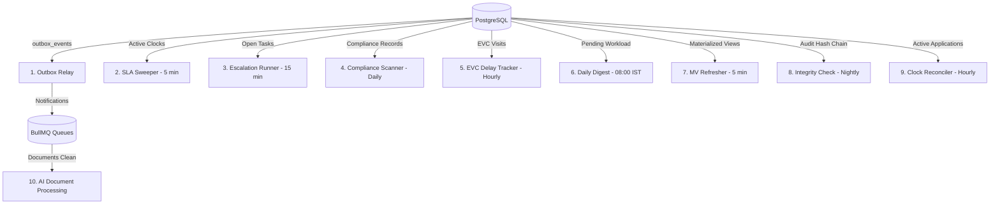

# AICTE Control Tower — Automation & Workflow Engine Architecture

## 1. Core State Machine Engine

### 1.1 Atomic Single-Transaction Transitions
State transitions are governed exclusively by `WorkflowService.transition(...)`. Every transition occurs inside a **single database transaction** executing the following 9 sequential steps:

1. **Lock Record**: `SELECT ... FROM applications WHERE id = $1 FOR UPDATE`. Verifies `expectedVersion` for optimistic locking.
2. **Transition Authorization**: Validates that `(track, from_state, action)` exists in `workflow_transitions`. Rejects illegal transitions with `409 Conflict` or `422 Unprocessable Entity`.
3. **Role & Tenancy Check**: Asserts actor role, institutional ownership, regional jurisdiction, and separation of duties (e.g. maker cannot approve).
4. **Pure Guards Registry**: Executes configured guards (`no_open_deficiency`, `all_required_docs_verified`, `evc_report_present`, `reason_present`, `clause_present`).
5. **SLA Calculation**: Calculates `due_at` from `sla_policies` using business hours calculated by `fn_business_seconds`.
6. **Dual-Clock Rules Execution**: Starts/stops `INSTITUTION` and `AICTE` clocks in `clock_events`. Asserts the single open clock invariant before commit.
7. **Task Synchronization**: Completes prior open task, auto-assigns next stage task (auto-returning to original reviewer on resubmission).
8. **Tamper-Evident Audit Logging**: Inserts an append-only row in `audit_log`, automatically hashed via `fn_compute_audit_hash()`.
9. **Outbox Event Creation**: Inserts into `outbox_events` to guarantee zero dual-write inconsistencies between Postgres and Redis/external systems.

---

## 2. Dual-Clock Rules (Rule 4)

| Transition / Event | INSTITUTION Clock | AICTE Clock | Holder |
|---|---|---|---|
| `DRAFT` → `SUBMITTED` | *Inactive* | **START** | Scrutiny Officer (Auto-assigned) |
| Deficiency Raised | **START** | **STOP** | Institution |
| Valid Resubmission | **STOP** | **START** | Same Scrutiny Reviewer |
| Scrutiny Cleared, EVC Required | *Inactive* | **CONTINUES** | EVC Committee / Regional Head |
| Final Decision (`APPROVED`/`REJECTED`) | *Inactive* | **STOP** | *None (Terminal)* |
| Compliance Required | **START** | **STOP** | Institution |

### Invariant Guarantee
The exclusion constraint `ex_no_simultaneous_open_clocks` in PostgreSQL enforces that at most **one clock** can be running for an active application at any point in time.

---

## 3. Background Workers (BullMQ)

The worker process (`apps/worker`) hosts 10 dedicated consumers and schedulers:



### 3.1 Worker Schedule Summary
- **Outbox Relay**: Continuous polling and dispatch of events.
- **SLA Sweeper** (5 min): Checks running clock duration against `sla_policies.duration_hours`.
- **Escalation Runner** (15 min): Evaluates multi-level ladder:
  - Level 1: 70% elapsed → Reminder notification.
  - Level 2: 100% elapsed → Overdue flag + alert to Regional Officer.
  - Level 3: Overdue + 24h → Escalation to Regional Head.
  - Level 4: Overdue + 72h → Escalation to Bureau Officer.
- **Compliance Scanner** (Daily 02:00 IST): Checks expiry dates and dispatches idempotent alerts at 90, 30, 7, and 0 days into `compliance_alerts`.
- **EVC Delay Tracker** (Hourly): Flags visits with overdue reports.
- **Daily Digest** (08:00 IST): Generates consolidated morning briefing for each officer.
- **Materialized Views Refresher** (5 min): Executes `REFRESH MATERIALIZED VIEW CONCURRENTLY` on all 6 reporting views.
- **Audit Integrity Check** (Nightly): Executes `SELECT * FROM fn_verify_audit_chain()`.

---

## 4. Time-Travel Engine (Demonstration Control)
All time-dependent services inject `ClockService.now()` rather than calling `Date.now()`.
Administrators can trigger virtual time advances via:
```http
POST /api/v1/admin/time-travel
{
  "hours": 72
}
```
This enables real-time demonstration of SLA warnings, multi-level escalations, and compliance expiry ladders without waiting days.
